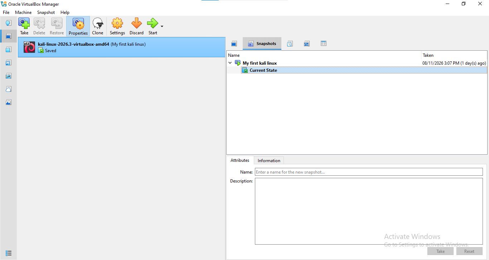
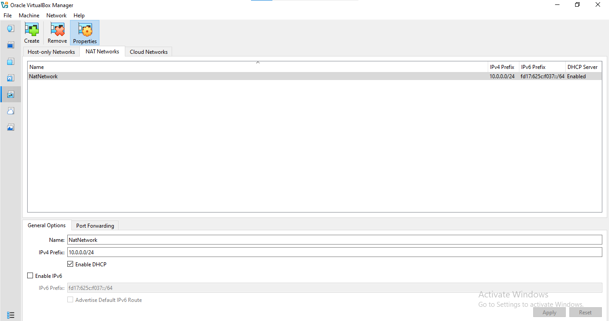

#My first project at networkwalks-B084-week1-Cybersecurity-lab-setup
# 🔐 Cybersecurity Lab Environment Setup

**Building an isolated virtual lab for penetration testing and ethical hacking practice**

  
  
  
  
  
  
  
  
  
  
  
  

---

## 📌 Project Overview

This project focuses on setting up a **virtual cybersecurity and penetration-testing laboratory** using VirtualBox and Kali Linux.

The purpose of the lab is to create a controlled environment where cybersecurity tools, network scanning, reconnaissance, vulnerability assessment, and other security-testing activities can be performed safely and repeatedly.

The lab is configured on a private virtual network so that additional machines can be added later and used as targets for authorized security testing.

---

## 🎯 Objectives

The main objectives of this project are to:

- Install and configure VirtualBox.
- Install/import Kali Linux as a virtual machine.
- Create a private **NAT Network** for the cybersecurity lab.
- Configure network connectivity for Kali Linux.
- Assign a consistent IP address to the Kali VM.
- Verify network connectivity and DNS resolution.
- Take a clean VM snapshot for recovery.
- Document the complete setup process.
- Prepare the environment for future cybersecurity projects.

---

## 🛡️ Purpose of the Lab

The lab provides an isolated and controlled environment for cybersecurity learning and authorized security testing.

It can be used for activities such as:

- Network reconnaissance
- Port scanning
- Vulnerability assessment
- Packet analysis
- Web security testing
- Exploitation practice
- Security-tool experimentation

⚠️ **Important:** This laboratory must only be used for systems that you own or have explicit permission to test. Do not use the lab or its tools to attack unauthorized systems.

---
[10:53 PM, 11/10/2026] 💫 Maryam ✨: ### Lab Environment

text
        Physical Computer
        (Windows Host)
               |
               |
        Oracle VirtualBox
               |
               |
        Virtual Machine
               |
               |
          Kali Linux
               |
               |
       Cybersecurity Lab

---

## ⚙️ System Configuration

| Component | Configuration |
|---|---|
| Host Operating System | Windows |
| Virtualization Software | Oracle VirtualBox |
| Guest Operating System | Kali Linux |
| Virtual Machine RAM | [Your RAM] |
| Virtual Machine CPU | [Your CPU allocation] |
| Virtual Disk | [Your disk size] |
| Network Mode | [NAT / Bridged / Host-only / NAT Network] |
[10:56 PM, 11/10/2026] 💫 Maryam ✨: ## 🚀 Lab Setup Process

### Step 1: Install Oracle VirtualBox

Downloaded and installed Oracle VirtualBox to create and manage virtual machines.
[11:16 PM, 11/10/2026] 💫 Maryam ✨: ### Step 2: Download Kali Linux

Downloaded the Kali Linux virtual machine image from the official Kali Linux website.

### Step 3: Import Kali Linux into VirtualBox

Imported the Kali Linux virtual machine into Oracle VirtualBox and configured its basic hardware settings.

### Step 4: Configure Virtual Machine Settings

Configured the virtual machine settings, including:

- RAM allocation
- Processor allocation
- Virtual hard disk
- Network adapter
- Display settings
- 

### Step 5: Start Kali Linux

Started the Kali Linux virtual machine and verified that the operating system was working correctly.

### Step 6: Verify Network Connectivity

Used Linux networking commands to check the IP address and network connectivity.

---## 🧠 What I Learned

Through this hands-on project, I gained practical knowledge of:

- Virtualization and virtual machine management.
- Installing and configuring Kali Linux.
- Basic Linux terminal commands.
- Understanding virtual network adapters.
- IP addressing and network connectivity.
- Working with a cybersecurity-focused operating system.
- Building a foundation for ethical hacking and penetration testing.

---

## 🔮 Future Improvements

I plan to expand this cybersecurity lab by adding:

- A Windows target virtual machine.
- Metasploitable 2 for vulnerability assessment.
- Network scanning exercises using Nmap.
- Wireshark for packet analysis.
- Basic penetration testing exercises.
- Vulnerability assessment and security testing.
- More practical cybersecurity projects.

---

